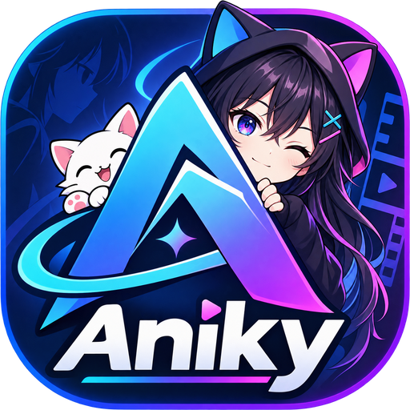
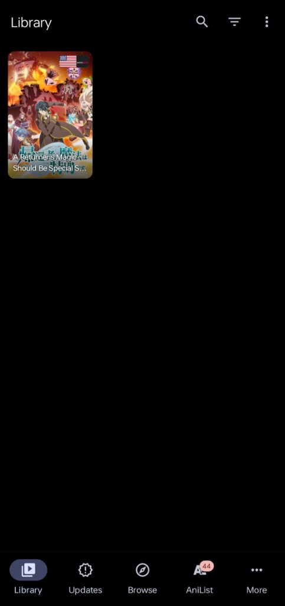
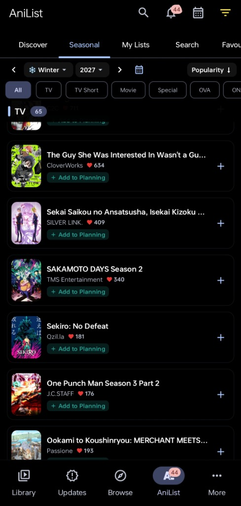
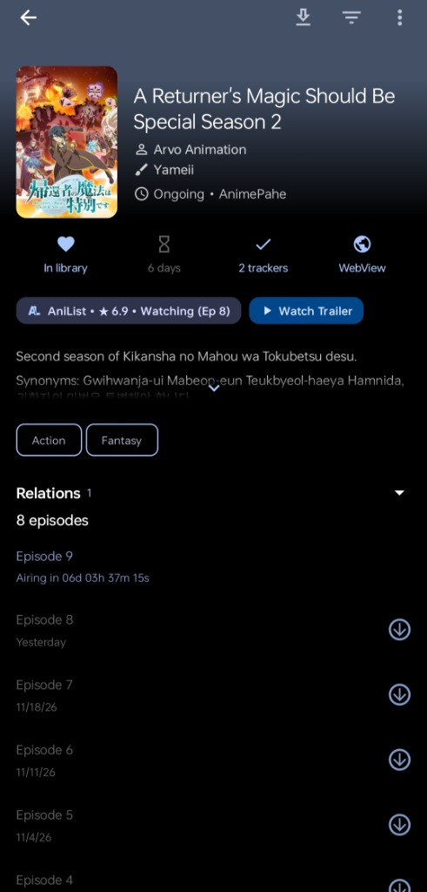
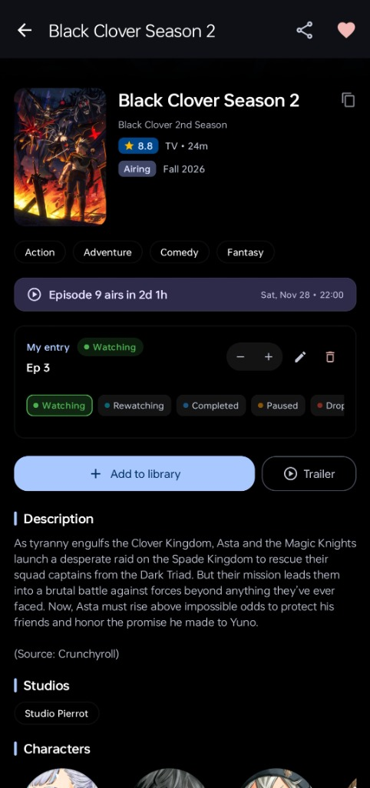
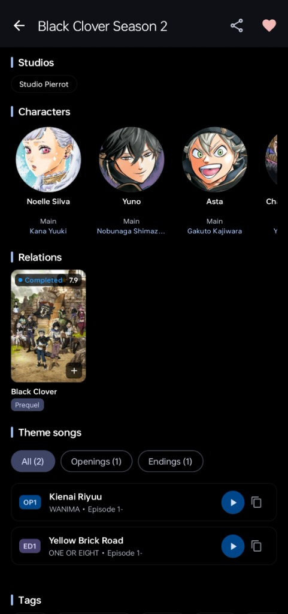

<div align="center">



# Aniky

**A sleek, modern anime app for Android** — built with native **AniList** discovery & tracking, a pitch-black **AMOLED** interface, and smooth hardware-accelerated playback.

Discover, track, download, and watch anime, cartoons, and series on your Android phone, tablet, or TV.

<br/>

[](https://github.com/anikydev/aniky/releases/latest)
[](https://t.me/anikydev)
[](https://developer.android.com/about/versions/oreo)
[](LICENSE)

</div>

---

## 📥 Download

[](https://github.com/anikydev/aniky/releases/latest)

Grab the APK matching your device from **[GitHub Releases](https://github.com/anikydev/aniky/releases/latest)**:

| Architecture | APK File | Recommended For |
|:---|:---|:---|
| **64-bit ARM** *(Recommended)* | `app-arm64-v8a-release.apk` | Most modern Android phones, tablets, and TV boxes |
| **32-bit ARM** | `app-armeabi-v7a-release.apk` | Older Android devices (32-bit) |

*Requires **Android 8.0 (Oreo)** or higher.*  
*Current version: **v1.0.0** — see [CHANGELOG.md](CHANGELOG.md) for full release notes.*  
*Join **[t.me/anikydev](https://t.me/anikydev)** on Telegram for update announcements and release news.*

---

## 📸 Sneak Peek

<p align="center">
  
  
  
  
  
</p>
<p align="center">
  <sub>Library · AniList Seasonal · Anime Details · AniList Tracking · Characters &amp; Themes</sub>
</p>

---

## ✨ Features

### 🌟 Native AniList Experience
- **Dedicated AniList Tab**: Browse *Discover* carousels (Trending, This Season, Next Season, Top Anime), *Seasonal Charts*, *Advanced Search*, *My Lists*, and *Favourites* right inside the app.
- **1-Tap Tracking & Entry Editor**: Quickly update watch status (`Watching`, `Planning`, `Completed`, `Paused`, `Dropped`, `Repeating`), increment episodes (`+1`), score titles, and edit dates with instant optimistic updates.
- **Weekly Airing Calendar**: View upcoming episode broadcasts and live countdowns with **My shows** (synced to your library) and **All anime** modes, day filters, and a quick **Today** jump button.
- **Rich Anime Details**: Inspect airing countdowns, franchise relations (prequels, sequels, side stories), community recommendations with vote counts, spoiler-tagged descriptions, and zoomable fullscreen cover & banner artwork.
- **In-App Trailers & OP/ED Previews**: Watch promotional trailers in-app and stream opening/ending theme videos and audio previews powered by AnimeThemes.
- **Studios, Characters & Voice Actors**: Explore complete animation studio catalogs, character profiles, voice actor filmographies with language tags, and fullscreen character portraits.
- **Notifications, Stats & Offline Queue**: Stay up to date with AniList notifications and watch statistics, plus automatic retry queueing so progress updates are never lost when rate-limited or offline.
- **1-Tap Source Matching**: Tap `+` on any AniList title to search your preferred or enabled extensions simultaneously, add the series to your library, and link AniList tracking in one step.

### 📱 Clean AMOLED Library & Interface
- **True Black AMOLED Theme**: Crisp `#000000` pitch-black surfaces with subtle container borders across tabs, cards, sheets, and startup splash — plus optional dynamic cover-based accent theming.
- **Continue Watching & Smart Resume**: Jump straight back into your latest watched episode from the top of your library, with smart `Resume · Ep X` / `Start · Ep X` buttons and episode range chips (`1–50`, `51–100`, etc.) for long-running series.
- **Fast Search & Filtering**: Active filter summary bar with 1-tap clear in Library, inline search and status chips (`All`, `Unwatched`, `Downloaded`, `Bookmarked`) in Updates, inline source search, and quick-add badges in Global Search.
- **Thoughtful Defaults**: Alphabetical (`A → Z`) library sorting out of the box, accidental episode swipe actions disabled by default, and a clutter-free navigation bar.

### 🎬 Video Player & Offline Downloads
- **MPV-Android Engine with HTTP/2**: Smooth, hardware-accelerated video playback with modern HTTP/2 streaming support, customizable subtitle styling, and external audio/subtitle track selection.
- **Long-Press 2× Speed**: Press and hold anywhere on the video player to temporarily speed up playback to `2×`, returning seamlessly when you let go.
- **Next-Episode Countdown**: Auto-advance prompt near the end of an episode with a 1-tap **Play Now** button.
- **Customizable Skip Button & AniSkip**: Persistent jump-ahead button (default `85s`, long-press to customize between `5s–300s`) alongside AniSkip intro/outro skipping.
- **Multi-Threaded Offline Downloader**: Built-in HTTP/2 video downloader supporting Direct, HLS, and DASH streams with `Range` resume, configurable threads (`1–64`), download speed limits, and local FFmpeg muxing.
- **TV, Cast & Discord**: Chromecast support, Android TV & Fire TV navigation support, and Discord Rich Presence.

### 🛠️ Organization, Sync & Backups
- **Tracker Two-Way Sync**: Synchronize watch progress seamlessly with **AniList** and **MyAnimeList**.
- **Feed, Categories & Mass Migration**: Multi-source Feed tab for saved searches and updates, flexible drag-and-drop & dynamic categories, anime merging, and bulk source migration.
- **Local & Cloud Backups**: Create local backups or sync your library across devices with SyncYomi and Google Drive.

---

## 💬 Community & Feedback

- **Telegram Channel:** [t.me/anikydev](https://t.me/anikydev) — release announcements and updates.
- **Bug Reports & Feature Requests:** Open a ticket via [GitHub Issues](https://github.com/anikydev/aniky/issues/new/choose).

> [!NOTE]
> Aniky does not host any media content and does not create, maintain, or provide third-party sources or extensions.

---

## 🛠️ Building from Source

<details>
<summary>Instructions for building Aniky locally</summary>

1. Clone the repository:
   ```bash
   git clone https://github.com/anikydev/aniky.git
   cd aniky
   ```

2. Create a `local.properties` file in the project root (gitignored) with your Android SDK path, OAuth client IDs (register apps on AniList and MyAnimeList using redirect URIs `app.aniky://anilist-auth` and `app.aniky://myanimelist-auth`), and optional release signing keystore:
   ```properties
   sdk.dir=C\:\\Android\\Sdk

   anilist.client_id=YOUR_ANILIST_CLIENT_ID
   mal.client_id=YOUR_MAL_CLIENT_ID

   # Optional release signing configuration
   release.storeFile=keystore/aniky-release.jks
   release.storePassword=YOUR_STORE_PASSWORD
   release.keyAlias=aniky
   release.keyPassword=YOUR_KEY_PASSWORD
   ```

3. Build with Gradle:
   ```bash
   ./gradlew assembleDebug
   ./gradlew assembleRelease
   ```

</details>

---

## Credits

Aniky is built upon **[Anikku](https://github.com/komikku-app/anikku)** (by the Komikku team), **[Aniyomi](https://github.com/aniyomiorg/aniyomi)**, and **[Mihon](https://mihon.app/)**, with player and media support powered by **[Animiru](https://github.com/quickdesh/Animiru)**, **mpv-android**, **AniList**, **MyAnimeList**, and **AnimeThemes**. All credit for the underlying engine belongs to those projects and their contributors.

---

## ⚖️ Disclaimer & License

The developer(s) of this application have no affiliation with any content providers, and this application hosts zero media content.

<div align="left">

```text
Copyright © 2015 Javier Tomás
Copyright © 2024 The Mihon Open Source Project
Copyright © 2024 The Aniyomi Open Source Project
Copyright © 2024 The Komikku Open Source Project

Licensed under the Apache License, Version 2.0 (the "License");
you may not use this file except in compliance with the License.
You may obtain a copy of the License at

    http://www.apache.org/licenses/LICENSE-2.0

Unless required by applicable law or agreed to in writing, software
distributed under the License is distributed on an "AS IS" BASIS,
WITHOUT WARRANTIES OR CONDITIONS OF ANY KIND, either express or implied.
See the License for the specific language governing permissions and
limitations under the License.
```

</div>
